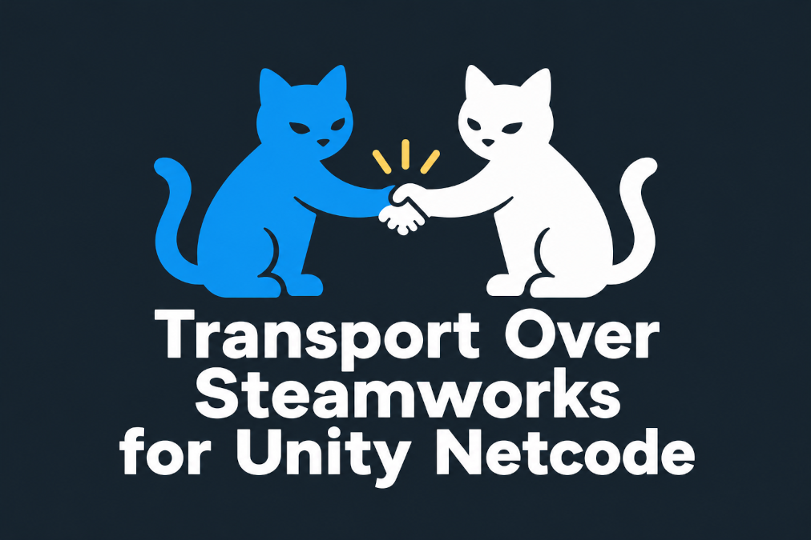

# Transport Over Steamworks for Unity Netcode



Network Transport for **[Unity Netcode](https://docs.unity3d.com/Packages/com.unity.netcode@latest/)** (a.k.a. "Netcode for Entities") implemented using [Steamworks SDK](https://partner.steamgames.com/doc/sdk) (*[ISteamNetworkingSockets](https://partner.steamgames.com/doc/api/ISteamNetworkingSockets)*).

- Created specifically for use with **Unity Netcode**.

- Can be used without it, with [Unity Transport](https://docs.unity3d.com/Packages/com.unity.transport@latest/) only.

- Tested with [Steamworks.NET](https://github.com/rlabrecque/steamworks.net).

- Supports **P2P**, **Fake IP**, and **real IP** connections. Servers/hosts can have all three types of listen sockets at the same time.

- Conversion between Steamworks messages <-> Unity Transport packets is done via **bursted jobs**.

**This package only handles the data transfer over Steamworks.  It doesn't initialize Steamworks, doesn't initialize Unity Netcode, doesn't handle matchmaking, doesn't initiate connections, doesn't start sockets etc.**

**It also doesn't bundle Steamworks.NET or the Steamworks SDK DLL.**


## Installation

1. Press the green button with the `<> Code`label above.
2. From there, copy the HTTPS URL of this repository (the one that you would use for cloning the repo).
3. In Unity, open the Package Manager.
4. Click the `+` button and select `Install package from git URL...`
5. Paste the URL and install the package.


## Getting started

This example shows how you can set up the host (the client-hosted server) and the client.


### Binary-worlds host

```csharp
// Step 1. Init Steamworks
// Step 2. (Optional) init relay network

// Step 3. Get sockets
var sockets = SteamNetworkDriverConstructor.GetSteamUserSockets();

// Step 4. Initialize network interfaces
SteamNetworkDriverConstructor.InitializeClientAndServer(
    sockets,
    SteamNetworkInterfaceType.IP,
    SteamNetworkInterfaceTypeFlags.IP | SteamNetworkInterfaceTypeFlags.P2P);

// Step 5. Create client and server worlds
// Step 6. Load your scene into the worlds
// Step 7. Create listen sockets, poll groups, and client conneciton via Steamworks

// Step 8. Create server (host) network endpoint
SteamNetworkEndpoint.CreateForListenSockets(
    out var serverEndpoint,
    SteamNetworkInterfaceTypeFlags.IP | SteamNetworkInterfaceTypeFlags.P2P,
    listenSocketP2P, pollGroupP2P,
    listenSocketIP, pollGroupIP);

// Step 9. Create client network endpoint
SteamNetworkEndpoint.CreateForConnection(
    out var clientEndpoint,
    SteamNetworkInterfaceTypeFlags.IP,
    clientConnection);

// Step 10. Use `NetworkStreamDriver.Listen(serverEndpoint)` in server world
// Step 11. Use `NetworkStreamDriver.Connect(clientEndpoint)` in client world
```


### Single-world host (since Unity Netcode 7.0)

In this case, the host doesn't use network connections to interact with itself. But you still likely want to use IP-based connections, for local testing (*it is also a good idea to not leave the IP-based connections in the final build, unless you intentionally support them*).

```csharp
// Step 1. Init Steamworks
// Step 2. (Optional) init relay network

// Step 3. Get sockets
var sockets = SteamNetworkDriverConstructor.GetSteamUserSockets();

// Step 4. Initialize network interfaces
SteamNetworkDriverConstructor.InitializeServer(
    sockets,
    SteamNetworkInterfaceTypeFlags.IP | // Still add IP to allow local testing
    SteamNetworkInterfaceTypeFlags.P2P);

// Step 5. Create combined world
// Step 6. Load your scene into the world
// Step 7. Create listen sockets and poll groups via Steamworks

// Step 8. Create server (host) network endpoint
SteamNetworkEndpoint.CreateForListenSockets(
    out var serverEndpoint,
    SteamNetworkInterfaceTypeFlags.IP | // Still add IP to allow local testing
    SteamNetworkInterfaceTypeFlags.P2P,
    listenSocketP2P, pollGroupP2P,
    listenSocketIP, pollGroupIP);

// Step 9. Use `NetworkStreamDriver.Listen(serverEndpoint)` in your world
```


### Client

For testing P2P clients, you need multiple machines running the Steam app with different Steam users. For the local testing, including via `Window -> Multiplayer -> Multiplayer Play Mode` from within Unity Editor, you should run IP-based clients.

```csharp
// Step 1. Init Steamworks
// Step 2. (Optional) init relay network

// Step 3. Get sockets
var sockets = SteamNetworkDriverConstructor.GetSteamUserSockets();

// Step 4. Initialize network interface
SteamNetworkDriverConstructor.InitializeClient(
    sockets, 
    SteamNetworkInterfaceType.P2P); // Or IP for local testing

// Step 5. Create client world
// Step 6. Load your scene into the world
// Step 7. Create client conneciton via Steamworks

// Step 8. Create client network endpoint
SteamNetworkEndpoint.CreateForConnection(
    out var clientEndpoint,
    SteamNetworkInterfaceTypeFlags.P2P, // Or IP for local testing
    clientConnection);

// Step 9. Use `NetworkStreamDriver.Connect(clientEndpoint)` in client world
```


### Disconnect

Disconnect is handled through Steamworks and Unity Netcode. Transport Over Steamworks is not involved.

*Unrelated to **Transport Over Steamworks** itself, but I should probably mention this. Disconnecting from Steamworks properly is very important. There are timeouts, and these timeouts only fix itself when Steamworks is deinitialized properly. At the very least, `SteamAPI.Shutdown();` is required. But I experienced a crash in Unity Editor on Linux when I didn't disconnect before calling it, which worked just fine on Windows.*


### Deinitialize

Whenever you want to reset the drivers in Unity Netcode to their default implementation, you can do so using `SteamNetworkDriverConstructor.Deinitialize();`


## API


### SteamNetworkDriverConstructor class

#### Sockets

```csharp
/// Returns the pointer to the Steamworks sockets.
/// Use this one to get the sockets for a Steam user
/// (the one logged into the currently running Steam app).
static IntPtr GetSteamUserSockets()
    
/// Returns the pointer to the Steamworks sockets.
/// Use this one to get the sockets for the Steamworks
/// game server (not tied to the Steam app).
static IntPtr GetSteamGameServerSockets()    
```
These methods return the pointer to the native *[ISteamNetworkingSockets](https://partner.steamgames.com/doc/api/ISteamNetworkingSockets)* object. They are exposed in the **Transport Over Steamworks** API to let **you** decide which sockets to use, instead of guessing internally. Should only be called after the call to `SteamAPI.Init()/GameServer.Init()` succeeded. Return `IntPtr.Zero` in case of error. 

Note that calling these methods is not required. If you obtained the sockets pointer in another way during your Steamworks setup, you may simply use it with other **Transport Over Steamworks** APIs.

#### Initialization

```csharp
/// Sets SteamNetworkDriverConstructor as the DriverConstructor in
/// Unity Netcode, so any new client drivers created after this call
/// use Steamworks as transport, while creation of any new server
/// drivers fails. You have to specify the Steamworks sockets pointer
/// and the client interface type (P2P, IP, FakeIP). Other parameters
/// are optional and include the Steamworks sockets send flags, the
/// number of received messages processed at once, and a list of
/// worlds in which existing drivers should be updated. Returns false
/// if the driver constructor was not set. Returns true in any other
/// case, including when updating any of the existing drivers fails.
static bool InitializeClient(
    IntPtr sockets,
    SteamNetworkInterfaceType clientInterface,
    SteamSendFlags sendFlags = Defaults.SendFlags,
    int messagesPerReceive = Defaults.MessagesPerReceive,
    List<World> worlds = null)
    
/// Sets SteamNetworkDriverConstructor as the DriverConstructor in
/// Unity Netcode, so any new server drivers created after this call
/// use Steamworks as transport, while creation of any new client
/// drivers fails. You have to specify the Steamworks sockets pointer
/// and the server interface types (P2P, IP, FakeIP). Other parameters
/// are optional and include the Steamworks sockets send flags, the
/// number of received messages processed at once, and a list of
/// worlds in which existing drivers should be updated. Returns false
/// if the driver constructor was not set. Returns true in any other
/// case, including when updating any of the existing drivers fails.
static bool InitializeServer(
    IntPtr sockets,
    SteamNetworkInterfaceTypeFlags serverInterfaces,
    SteamSendFlags sendFlags = Defaults.SendFlags,
    int messagesPerReceive = Defaults.MessagesPerReceive,
    List<World> worlds = null)
            
/// Sets SteamNetworkDriverConstructor as the DriverConstructor in
/// Unity Netcode, so any new drivers created after this call
/// use Steamworks as transport. You have to specify the Steamworks 
/// sockets pointer, the client interface type (P2P, IP, FakeIP), 
/// and the server interface types (P2P, IP, FakeIP). Other parameters
/// are optional and include the Steamworks sockets send flags, the
/// number of received messages processed at once, and a list of
/// worlds in which existing drivers should be updated. Returns false
/// if the driver constructor was not set. Returns true in any other
/// case, including when updating any of the existing drivers fails.
static bool InitializeClientAndServer(
    IntPtr sockets,
    SteamNetworkInterfaceType clientInterface,
    SteamNetworkInterfaceTypeFlags serverInterfaces,
    SteamSendFlags sendFlags = Defaults.SendFlags,
    int messagesPerReceive = Defaults.MessagesPerReceive,
    List<World> worlds = null)      
```

#### Cleanup

```csharp   
/// Resets the DriverConstructor in Unity Netcode to DefaultDriverConstructor,
/// so any new drivers created after this call use the default transport. You
/// can specify a list of worlds in which existing drivers should be updated.
static void Deinitialize(List<NetcodeWorld> worlds = null)
```


### Enums

#### SteamNetworkInterfaceType

```csharp
/// Client connection types (you can only have one, not including None).
[PublicAPI]
public enum SteamNetworkInterfaceType {
    None = 0, // = Default = Invalid
    P2P = 1,
    IP = 2,
    FakeIP = 3
}
```

#### SteamNetworkInterfaceTypeFlags

```csharp
/// Server connection types (you can have up to three, not including None).
[Flags]
[PublicAPI]
public enum SteamNetworkInterfaceTypeFlags {
    None = 0, // = Default = Invalid
    P2P = 1,
    IP = 2,
    FakeIP = 4
}
```

#### SteamSendFlags

- [steamnetworkingtypes.h](https://partner.steamgames.com/doc/api/steamnetworkingtypes)
- [SendMessageToConnection](https://partner.steamgames.com/doc/api/ISteamNetworkingSockets#SendMessageToConnection)

```csharp
/// The send flags as described in the Steamworks SDK documentation for steamnetworkingtypes.h
/// (https://partner.steamgames.com/doc/api/steamnetworkingtypes) and SendMessageToConnection
/// (https://partner.steamgames.com/doc/api/ISteamNetworkingSockets#SendMessageToConnection).
/// Use these flags to control how the Steamworks connection behaves.
[Flags]
[PublicAPI]
public enum SteamSendFlags {
    Unreliable = 0,
    NoNagle = 1,
    UnreliableNoNagle = Unreliable | NoNagle,
    NoDelay = 4,
    UnreliableNoDelay = Unreliable | NoDelay | NoNagle,
    Reliable = 8,
    ReliableNoNagle = Reliable | NoNagle,
    UseCurrentThread = 16,
    AutoRestartBrokenSession = 32
}
```


### SteamNetworkEndpoint class

Use this class to deal with the `NetworkEndpoint` structs containing Steamworks socket/connection data.

```csharp
/// Creates a new NetworkEndpoint containing the provided interface
/// type, connection and poll group. The NetworkEndpoint.Family is
/// set to NetworkFamily.Custom. No parameter validation is performed.
/// Can be called from bursted code.
static void CreateForConnection(
    out NetworkEndpoint endpoint,
    SteamNetworkInterfaceType type = SteamNetworkInterfaceType.None,
    uint connection = 0, uint pollGroup = 0)
    
/// Creates a new NetworkEndpoint containing the provided interface
/// types, listen sockets and poll groups. The NetworkEndpoint.Family is
/// set to NetworkFamily.Custom. No parameter validation is performed.
/// Can be called from bursted code.
static void CreateForListenSockets(
    out NetworkEndpoint endpoint,
    SteamNetworkInterfaceTypeFlags types = SteamNetworkInterfaceTypeFlags.None,
    uint listenSocketP2P = 0, uint pollGroupP2P = 0,
    uint listenSocketIP = 0, uint pollGroupIP = 0,
    uint listenSocketFakeIP = 0, uint pollGroupFakeIP = 0)
    
/// Fills the specified NetworkEndpoint with the provided interface
/// type, connection and poll group. The NetworkEndpoint.Family is
/// set to NetworkFamily.Custom. No parameter validation is performed.
/// Can be called from bursted code.
static void SetSteamConnection(
    this ref NetworkEndpoint endpoint,
    SteamNetworkInterfaceType type = SteamNetworkInterfaceType.None,
    uint connection = 0, uint pollGroup = 0)

/// Fills the specified NetworkEndpoint with the provided interface
/// types, listen sockets and poll groups. The NetworkEndpoint.Family is
/// set to NetworkFamily.Custom. No parameter validation is performed.
/// Can be called from bursted code.
static void SetSteamListenSockets(
    this ref NetworkEndpoint endpoint,
    SteamNetworkInterfaceTypeFlags types = SteamNetworkInterfaceTypeFlags.None,
    uint listenSocketP2P = 0, uint pollGroupP2P = 0,
    uint listenSocketIP = 0, uint pollGroupIP = 0,
    uint listenSocketFakeIP = 0, uint pollGroupFakeIP = 0)

/// Extracts the interface type, connection, and poll
/// group from the specified NetworkEndpoint. It is on
/// the caller to ensure that NetworkEndpoint contains the
/// appropriate connection data before calling this method.
/// Can be called from bursted code.
static void GetSteamConnection(
    this ref NetworkEndpoint endpoint,
    out SteamNetworkInterfaceType type,
    out uint connection, out uint pollGroup)

    
/// Extracts the interface types, listen sockets, and poll
/// groups from the specified NetworkEndpoint. It is on
/// the caller to ensure that NetworkEndpoint contains the
/// appropriate connection data before calling this method.
/// Can be called from bursted code.
static void GetSteamListenSockets(
   this in NetworkEndpoint endpoint,
   out SteamNetworkInterfaceTypeFlags types,
   out uint listenSocketP2P, out uint pollGroupP2P,
   out uint listenSocketIP, out uint pollGroupIP,
   out uint listenSocketFakeIP, out uint pollGroupFakeIP)
```


### SteamNetworkInterface struct

The actual interface passed to [Unity Transport](https://docs.unity3d.com/Packages/com.unity.transport@latest/) to streamline the messages through Steamworks SDK. In most cases you don't have to interact with it directly. 

It is only made public to enable custom setup without the use of `SteamNetworkDriverConstructor`. In which case you are only interested in its constructors, as other methods are called by Unity Transport.

It exposes two constructors that are essentially the same, except one does not depend on `NetDebug`, and the other does, and thus is only available when Unity Netcode is installed.

```csharp
SteamNetworkInterface(
    bool isServer, 
    IntPtr sockets, 
    SteamNetworkInterfaceType interfaceType, 
    SteamSendFlags sendFlags = Defaults.SendFlags, 
    int messagesPerReceive = Defaults.MessagesPerReceive)

SteamNetworkInterface(
    in NetDebug netDebug, 
    bool isServer, 
    IntPtr sockets, 
    SteamNetworkInterfaceType interfaceType, 
    SteamSendFlags sendFlags = Defaults.SendFlags,
    int messagesPerReceive = Defaults.MessagesPerReceive)
```

`isServer` should be set to `true` if the interface is used for a server, **including client hosts**, and to `false` if it is used for a client. 

Other parameters are similar to `SteamNetworkDriverConstructor.Initialize...` methods.


### Debugging and optimization


| Name                                         | Description                                                                                                                                                                                                                                                        | 
|------------------------------------------------|--------------------------------------------------------------------------------------------------------------------------------------------------------------------------------------------------------------------------------------------------------------------|
| `TRANSPORT_OVER_STEAMWORKS_DISABLE_LOGGING`    | Disables logging (and tracing, if enabled) in **Transport Over Steamworks**.                                                                                                                                                                                    |
| `TRANSPORT_OVER_STEAMWORKS_ENABLE_TRACING`     | Enables tracing in **Transport Over Steamworks**. To see the tracing logs, you should go to `Window -> Multiplayer -> Play Mode Tools`, enable `Force Log Settings` and select the `Debug` log level. For builds, you can enable the needed log level via code. |
| `TRANSPORT_OVER_STEAMWORKS_DISABLE_RICH_LOGS`| Disables the Rich Text tags in **Transport Over Steamworks** log messages. This only affects Editor, as Rich Text is disabled in builds.                                                                                                                      |


There are some collection checks under `ENABLE_UNITY_COLLECTIONS_CHECKS` in both bursted and not bursted code. These checks will likely not be present in release builds.


## Known issues and limitations


- **Transport Over Steamworks** doesn't check whether SteamAPI/GameServer, Relay Network, or anything else is initialized and available. It always calls into native functions, as Steamworks SDK promises to handle this. If that's not enough, you can handle this manually at a higher level.


- Send/Receive jobs that do Steamworks <-> Netcode message conversion aren't parallelized. Processing received messages in parallel seems doable, but for sending, the previous job should be synchronized (otherwise, I found no way to get the number of Netcode packets in the queue), which makes it not worth it. All other implementations of `INetworkInterace` I've seen so far also run their jobs synchronously.


- The `NetworkEndpoint` for listen sockets is composite, so you start all listen sockets in a single `Listen` call. This is due to how Unity Netcode handles listening: it loops over all existing drivers, and if a driver is already listening, it throws an exception.


- Sockets interface version is hardcoded in *SteamAPI.cs*, and I need to update this version whenever the native Steamworks library upgrades the sockets interface. This is a limitation of Steamworks SDK. Steamworks.NET has the same issue. In case you need to do this yourself, you can copy the package to *Packages* folder (Unity Package Manager has the `Customize` option hidden in a dropdown, which does exactly this), find *Runtime/NetworkTransportOverSteamworks/Internal/NativeAPI/SteamAPI.cs*, then `NetworkTransportOverSteamworks.SteamAPI.SocketsVersion` inside of it, and change the version. This should work for as long as the actual Steamworks APIs used by **Transport Over Steamworks** remain unchanged.


## AI use disclosure

- The initial prototype was implemented by AI. It was then fully rewritten manually, except that I did few AI requests that resulted in some minor code changes.
- I extensively consulted with AI to get a better understanding of Steamworks SDK and how it can be integrated with Unity Netcode. 
- Logo image was generated with AI. 
- Few documentation comments were improved with AI.
- AI autocompletion was enabled in the IDE. 


## License

[MIT](LICENSE.md)

```
MIT License

Copyright (c) 2026 Vladimir Klubkov

Permission is hereby granted, free of charge, to any person obtaining a copy
of this software and associated documentation files (the "Software"), to deal
in the Software without restriction, including without limitation the rights
to use, copy, modify, merge, publish, distribute, sublicense, and/or sell
copies of the Software, and to permit persons to whom the Software is
furnished to do so, subject to the following conditions:

The above copyright notice and this permission notice shall be included in all
copies or substantial portions of the Software.

THE SOFTWARE IS PROVIDED "AS IS", WITHOUT WARRANTY OF ANY KIND, EXPRESS OR
IMPLIED, INCLUDING BUT NOT LIMITED TO THE WARRANTIES OF MERCHANTABILITY,
FITNESS FOR A PARTICULAR PURPOSE AND NONINFRINGEMENT. IN NO EVENT SHALL THE
AUTHORS OR COPYRIGHT HOLDERS BE LIABLE FOR ANY CLAIM, DAMAGES OR OTHER
LIABILITY, WHETHER IN AN ACTION OF CONTRACT, TORT OR OTHERWISE, ARISING FROM,
OUT OF OR IN CONNECTION WITH THE SOFTWARE OR THE USE OR OTHER DEALINGS IN THE
SOFTWARE.
```

The platform define guard in the begining of each source file was copied from [Steamworks.NET](https://github.com/rlabrecque/steamworks.net). Steamworks.NET is distributed under the [MIT](Third%20Party%20Notices.md) license:

```
The MIT License (MIT)

Copyright (c) 2013-2022 Riley Labrecque

Permission is hereby granted, free of charge, to any person obtaining a copy
of this software and associated documentation files (the "Software"), to deal
in the Software without restriction, including without limitation the rights
to use, copy, modify, merge, publish, distribute, sublicense, and/or sell
copies of the Software, and to permit persons to whom the Software is
furnished to do so, subject to the following conditions:

The above copyright notice and this permission notice shall be included in
all copies or substantial portions of the Software.

THE SOFTWARE IS PROVIDED "AS IS", WITHOUT WARRANTY OF ANY KIND, EXPRESS OR
IMPLIED, INCLUDING BUT NOT LIMITED TO THE WARRANTIES OF MERCHANTABILITY,
FITNESS FOR A PARTICULAR PURPOSE AND NONINFRINGEMENT. IN NO EVENT SHALL THE
AUTHORS OR COPYRIGHT HOLDERS BE LIABLE FOR ANY CLAIM, DAMAGES OR OTHER
LIABILITY, WHETHER IN AN ACTION OF CONTRACT, TORT OR OTHERWISE, ARISING FROM,
OUT OF OR IN CONNECTION WITH THE SOFTWARE OR THE USE OR OTHER DEALINGS IN
THE SOFTWARE.
```
